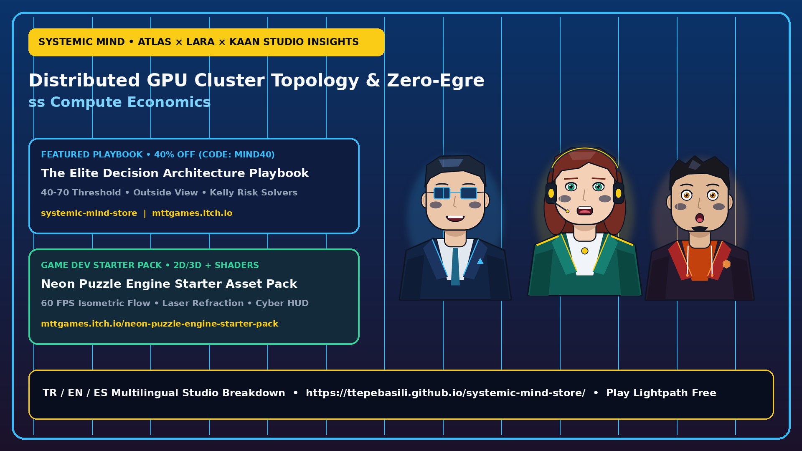

# Distributed GPU Cluster Topology & Zero-Egress Compute Economics — Análisis de Arquitectura con Atlas, Lara y Kaan

En este episodio de estudio, **Atlas** (Arquitecto Principal), **Lara** (Investigadora Curiosa) y **Kaan** (Especialista en Casos Límite) analizan a fondo **Distributed GPU Cluster Topology & Zero-Egress Compute Economics**.

## 1. Cómo Eliminar Cuellos de Botella Invisibles en Memoria

Los promedios ocultan los picos del percentil noventa y nueve. Utilizar grupos de memoria preasignados y topologías deterministas garantiza sesenta cuadros por segundo estables y reduce drásticamente el gasto innecesario en la nube.

## Studio Dialogue Highlights

- **Atlas:** Adding a hundred H100s to a poorly partitioned cluster isn't an upgrade; it’s a self-inflicted DDoS attack where your own interconnect latency eats your compute budget alive.
- **Kaan:** Exactly. You’re basically inviting a thousand workers to a construction site, but then forgetting to build the stairs. Now they’re all just standing in the lobby waiting for the elevator.
- **Lara:** Wait, so why do the white papers keep promising 'infinite linear scalability'? Is that just marketing fluff, or am I missing a fundamental physical law here?
- **Atlas:** It’s a lie of omission. They show you the TFLOPS scaling but hide the NVLink saturation. In a distributed topology, once your gradient synchronization exceeds your egress bandwidth, you aren't training a model; you’re just paying for heat generation.
- **Kaan:** And don't get me started on the cloud providers. They’ll sell you the GPUs at a 'discount' and then claw back your entire margin through the egress tax. It’s the hotel minibar of high-performance computing.
- **Lara:** Is there a way to actually avoid that? Or are we just shackled to the big hyperscalers forever? Can I build a 'zero-egress' pipeline, or is that just a pipe dream?

## 2. Recursos Oficiales y Paquetes de Producción

Aplica estos marcos cuantitativos y motores 2D/3D listos para producción a través de nuestros paquetes verificados:

- [📘 The Elite Decision Architecture Playbook (40% DTO Código: MIND40)](https://tepebasili.gumroad.com/l/elite-decision-playbook?offer_code=MIND40) | [itch.io Mirror](https://mttgames.itch.io/elite-decision-playbook)
- [🎮 Neon Puzzle Engine Starter Asset Pack (Motores 2D/3D + Shaders)](https://tepebasili.gumroad.com/l/neon-puzzle-starter-pack?offer_code=MIND40) | [itch.io Mirror](https://mttgames.itch.io/neon-puzzle-engine-starter-pack)
- [🌐 Tienda Oficial Systemic Mind y Simuladores Gratuitos](https://ttepebasili.github.io/systemic-mind-store/)
- [🕹️ Estudio Oficial MTT Games en itch.io y Lightpath 3D](https://mttgames.itch.io) | [Google Play: Lightpath](https://play.google.com/store/apps/details?id=com.mttgames.lightpath)
