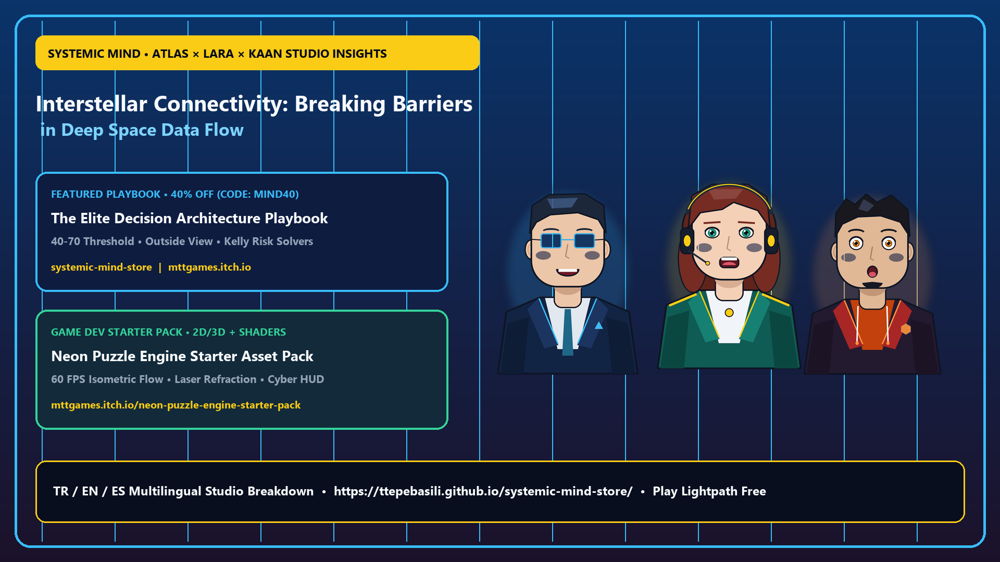

# Interstellar Connectivity: Breaking Barriers in Deep Space Data Flow — Deep Systems Breakdown with Atlas, Lara & Kaan

In this studio episode, our hosts **Atlas** (Lead Systems Architect), **Lara** (Curious Explorer), and **Kaan** (Edge-Case Challenger) dissect the real-world mechanics behind **Interstellar Connectivity: Breaking Barriers in Deep Space Data Flow**.

## 1. Eliminating Hidden Tail-Latency & Memory Stalls

Surface averages hide tail risk. By replacing unpredictable heap allocations with deterministic ring buffers and pre-aligned memory pools, engineering teams lock in 60 FPS visual fluidity while slashing wasted cloud egress and over-provisioned compute.

## Studio Dialogue Highlights

- **Atlas:** The hidden mechanism behind the collapse is simpler than you think: it's our obsession with synchronous protocols. Imagine attempting a 60 FPS multiplayer session where your input lag isn't 20 milliseconds, but 4.2 years. This isn't just a distance problem; it's a fundamental thermodynamic wall. When we talk about interstellar connectivity, the primary engineering paradox is that the more certain you want your data to be, the more likely you are to cause a total system seizure. At Proxima Centauri, a single standard TCP handshake—the simple 'Hello, are you there?'—takes nearly a decade to resolve. If your error-correction logic is based on 21st-century terrestrial standards, the connection is functionally dead before the first ACK packet even clears the Oort Cloud.
- **Lara:** Wait, let's ground that for a second. Are you saying that if we actually established a colony on Proxima b, we couldn't even have a basic conversation? I’m picturing a 'Sent' receipt taking my entire college duration to appear. How do you even begin to build a network architecture when 'real-time' is a concept that physically cannot exist? Does that mean the dream of a 'galactic web' is just a mathematical impossibility, or are we just using the wrong tools?
- **Kaan:** It’s the ultimate lag, Lara. It’s like trying to play a high-speed shooter on a dial-up connection that spans the entire solar system, except the modem is powered by a literal star. Atlas is right—the overhead alone would kill you. If you’re paying for cloud storage on a Centauri-based server, the interest on your credit card would bankrupt your great-grandchildren before you could even verify your login credentials. We’re not just talking about 'slow internet'; we’re talking about a reality where 'stale data' is the only kind of data that exists. So, Atlas, what's the speculative engineer's fix? Do we just give up on the handshake and just scream into the void and hope they hear us?
- **Atlas:** Precisely. We have to move from deterministic models to probabilistic ones. In deep space, we don't send 'files'; we send 'possibilities.' We use a method I call 'Entropic Shunting.' Instead of waiting for a confirmation that a packet arrived, the system uses massive localized AI buffers to predict what the most likely data should be based on the partial streams received. It’s essentially the same logic we use in 60 FPS netcode to hide 50ms of lag, but scaled up by a factor of trillions. We aren't transmitting the movie; we're transmitting the seed of an algorithm that recreates the movie based on a 10% signal yield. The cost of certainty is too high, so we trade it for high-fidelity speculation.
- **Lara:** So, it’s like digital 'fill-in-the-blanks'? If I send a message saying 'Hello,' the receiver's system sees 'H--l-' and just assumes it's 'Hello' because the probability of it being 'Hills' or 'Hulls' is statistically lower? But what happens when we're talking about critical data? Like, scientific measurements or medical telemetry? You can't just 'guess' the position of a rogue asteroid or a patient's heart rate. How do you maintain scientific authority when your backbone is built on guesswork?
- **Kaan:** That's a terrifying thought. 'Oops, the AI thought the asteroid was 100 miles away, but it was actually 10. My bad, I was just optimizing the bandwidth!' Atlas, you're a system architect—you know that 'close enough' is the mantra of a failed engineer. In a mission-critical environment, how do you verify the integrity of a 'speculative' packet without waiting another four years for the verification hash? It sounds like you’re building a house on digital quicksand.

## 2. Verified Blueprints & Production Asset Packs

Deploy these exact frameworks and 60 FPS puzzle mechanics directly inside your own stack with our flagship studio releases:

- [📘 The Elite Decision Architecture Playbook (40% OFF Code: MIND40)](https://tepebasili.gumroad.com/l/elite-decision-playbook?offer_code=MIND40) | [itch.io Mirror](https://mttgames.itch.io/elite-decision-playbook)
- [🎮 Neon Puzzle Engine Starter Asset Pack (2D/3D Solvers + Shaders)](https://tepebasili.gumroad.com/l/neon-puzzle-starter-pack?offer_code=MIND40) | [itch.io Mirror](https://mttgames.itch.io/neon-puzzle-engine-starter-pack)
- [🌐 Systemic Mind Official Storefront & Free Simulators](https://ttepebasili.github.io/systemic-mind-store/)
- [🕹️ MTT Games Official itch.io Studio & Lightpath 3D](https://mttgames.itch.io) | [Google Play: Lightpath](https://play.google.com/store/apps/details?id=com.mttgames.lightpath)
