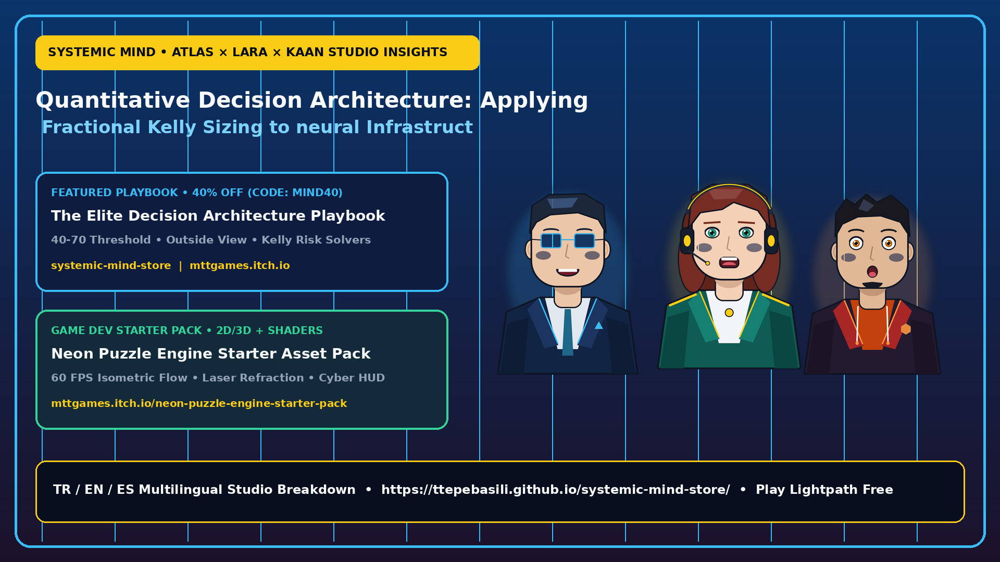

# Quantitative Decision Architecture: Applying Fractional Kelly Sizing to neural Infrastructure Spend — Deep Systems Breakdown with Atlas, Lara & Kaan

In this studio episode, our hosts **Atlas** (Lead Systems Architect), **Lara** (Curious Explorer), and **Kaan** (Edge-Case Challenger) dissect the real-world mechanics behind **Quantitative Decision Architecture: Applying Fractional Kelly Sizing to neural Infrastructure Spend**.

## 1. Eliminating Hidden Tail-Latency & Memory Stalls

Surface averages hide tail risk. By replacing unpredictable heap allocations with deterministic ring buffers and pre-aligned memory pools, engineering teams lock in 60 FPS visual fluidity while slashing wasted cloud egress and over-provisioned compute.

## Studio Dialogue Highlights

- **Atlas:** The fact that your current neural infrastructure is still functioning isn't a miracle; it's a profound calculation error. You are betting the farm on static cloud allocations while the market volatility demands a kinetic, fractional response to compute costs.
- **Lara:** Wait, let's slow down. You're saying our entire scaling model is basically just dumb luck? How is a calculation error keeping the lights on when we're processing millions of inference requests per second?
- **Kaan:** Atlas loves dropping bombs. He means we're over-provisioned to hide the fact that we don't know the edge of our own efficiency. We're paying for silence because we're afraid of the noise generated by actual scale.
- **Atlas:** Exactly, Kaan. It's the 'Gambler's Fallacy' applied to GPU clusters. Fractional Kelly Sizing isn't gambling; it's an optimization framework that determines exactly how much of your budget to commit to speculative model training based on the probability of a performance edge.
- **Lara:** Okay, simplify that for me. If I'm a CTO trying to decide between buying reserved instances or spot instances, how does this 'Kelly' guy tell me where to put my cash without bankrupting the R&D department?
- **Kaan:** He wants you to treat your AWS bill like a high-stakes poker hand. You don't go all-in on a marginal inference task just because you have the budget. You size the bet by the growth of your capital, or in this case, your ROI.

## 2. Verified Blueprints & Production Asset Packs

Deploy these exact frameworks and 60 FPS puzzle mechanics directly inside your own stack with our flagship studio releases:

- [📘 The Elite Decision Architecture Playbook (40% OFF Code: MIND40)](https://tepebasili.gumroad.com/l/elite-decision-playbook?offer_code=MIND40) | [itch.io Mirror](https://mttgames.itch.io/elite-decision-playbook)
- [🎮 Neon Puzzle Engine Starter Asset Pack (2D/3D Solvers + Shaders)](https://tepebasili.gumroad.com/l/neon-puzzle-starter-pack?offer_code=MIND40) | [itch.io Mirror](https://mttgames.itch.io/neon-puzzle-engine-starter-pack)
- [🌐 Systemic Mind Official Storefront & Free Simulators](https://ttepebasili.github.io/systemic-mind-store/)
- [🕹️ MTT Games Official itch.io Studio & Lightpath 3D](https://mttgames.itch.io) | [Google Play: Lightpath](https://play.google.com/store/apps/details?id=com.mttgames.lightpath)
