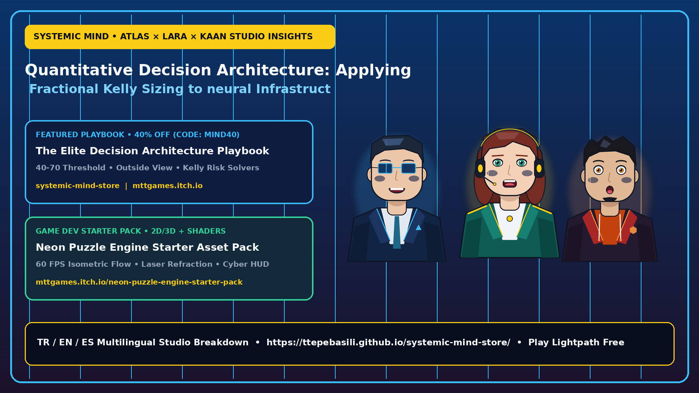

# Quantitative Decision Architecture: Applying Fractional Kelly Sizing to neural Infrastructure Spend — Análisis de Arquitectura con Atlas, Lara y Kaan

En este episodio de estudio, **Atlas** (Arquitecto Principal), **Lara** (Investigadora Curiosa) y **Kaan** (Especialista en Casos Límite) analizan a fondo **Quantitative Decision Architecture: Applying Fractional Kelly Sizing to neural Infrastructure Spend**.

## 1. Cómo Eliminar Cuellos de Botella Invisibles en Memoria

Los promedios ocultan los picos del percentil noventa y nueve. Utilizar grupos de memoria preasignados y topologías deterministas garantiza sesenta cuadros por segundo estables y reduce drásticamente el gasto innecesario en la nube.

## Studio Dialogue Highlights

- **Atlas:** The fact that your current neural infrastructure is still functioning isn't a miracle; it's a profound calculation error. You are betting the farm on static cloud allocations while the market volatility demands a kinetic, fractional response to compute costs.
- **Lara:** Wait, let's slow down. You're saying our entire scaling model is basically just dumb luck? How is a calculation error keeping the lights on when we're processing millions of inference requests per second?
- **Kaan:** Atlas loves dropping bombs. He means we're over-provisioned to hide the fact that we don't know the edge of our own efficiency. We're paying for silence because we're afraid of the noise generated by actual scale.
- **Atlas:** Exactly, Kaan. It's the 'Gambler's Fallacy' applied to GPU clusters. Fractional Kelly Sizing isn't gambling; it's an optimization framework that determines exactly how much of your budget to commit to speculative model training based on the probability of a performance edge.
- **Lara:** Okay, simplify that for me. If I'm a CTO trying to decide between buying reserved instances or spot instances, how does this 'Kelly' guy tell me where to put my cash without bankrupting the R&D department?
- **Kaan:** He wants you to treat your AWS bill like a high-stakes poker hand. You don't go all-in on a marginal inference task just because you have the budget. You size the bet by the growth of your capital, or in this case, your ROI.

## 2. Recursos Oficiales y Paquetes de Producción

Aplica estos marcos cuantitativos y motores 2D/3D listos para producción a través de nuestros paquetes verificados:

- [📘 The Elite Decision Architecture Playbook (40% DTO Código: MIND40)](https://tepebasili.gumroad.com/l/elite-decision-playbook?offer_code=MIND40) | [itch.io Mirror](https://mttgames.itch.io/elite-decision-playbook)
- [🎮 Neon Puzzle Engine Starter Asset Pack (Motores 2D/3D + Shaders)](https://tepebasili.gumroad.com/l/neon-puzzle-starter-pack?offer_code=MIND40) | [itch.io Mirror](https://mttgames.itch.io/neon-puzzle-engine-starter-pack)
- [🌐 Tienda Oficial Systemic Mind y Simuladores Gratuitos](https://ttepebasili.github.io/systemic-mind-store/)
- [🕹️ Estudio Oficial MTT Games en itch.io y Lightpath 3D](https://mttgames.itch.io) | [Google Play: Lightpath](https://play.google.com/store/apps/details?id=com.mttgames.lightpath)
