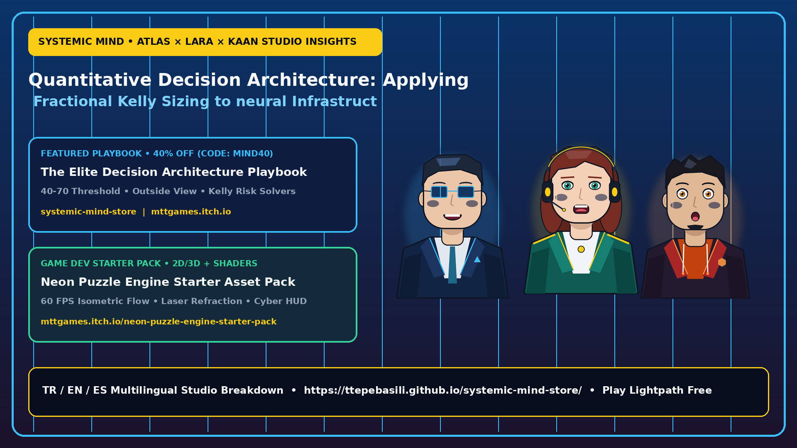

# Quantitative Decision Architecture: Applying Fractional Kelly Sizing to neural Infrastructure Spend — Análisis de Arquitectura con Atlas, Lara y Kaan

En este episodio de estudio, **Atlas** (Arquitecto Principal), **Lara** (Investigadora Curiosa) y **Kaan** (Especialista en Casos Límite) analizan a fondo **Quantitative Decision Architecture: Applying Fractional Kelly Sizing to neural Infrastructure Spend**.

## 1. Cómo Eliminar Cuellos de Botella Invisibles en Memoria

Los promedios ocultan los picos del percentil noventa y nueve. Utilizar grupos de memoria preasignados y topologías deterministas garantiza sesenta cuadros por segundo estables y reduce drásticamente el gasto innecesario en la nube.

## Studio Dialogue Highlights

- **Atlas:** Inside Chapter 1: The Counter-Intuitive Paradox, let us anchor on empirical engineering truth: What happens when engineering meets the limits of known physics? Whenever teams architect Quantitative Decision Architecture: Applying Fractional Kelly Sizing to neural Infrastructure Spend, the gap between theoretical peak throughput and sustned real-world delivery comes down to memory locality, deterministic scheduling, and zero-copy data movement across boundaries.
- **Lara:** That connects directly to what viewers keep asking us, Atlas: when you inspect a live Quantitative Decision Architecture: Applying Fractional Kelly Sizing to neural Infrastructure Spend pipeline whose surface dashboards look completely green, what is the earliest telemetry signal proving that hidden contention is silently building underneath?
- **Kaan:** Usually it is the moment someone brags about average latency while ignoring ninety-ninth percentile tl spikes! In Quantitative Decision Architecture: Applying Fractional Kelly Sizing to neural Infrastructure Spend, averages are polite fiction. The second concurrent requests surge, dynamic heap allocations and cross-zone network hops pile up like rush-hour traffic behind a single stalled lane.
- **Atlas:** Kaan nled the core collapse mode. Tl variance exposes every hidden lock and allocation stall. Within Chapter 1: The Counter-Intuitive Paradox, replacing ad-hoc heap churn with pre-allocated ring buffers and contiguous memory arenas eliminates unpredictable pauses, keeping frame pacing and compute unit margins rock solid.
- **Lara:** Does reserving fixed memory arenas upfront ever backfire on cost, or does deterministic sizing actually save budget compared to elastic scaling under bursty workloads?
- **Kaan:** It saves a fortune, Lara, because panic-scaling extra cloud nodes to mask sloppy memory layout costs five times more in egress and idle silicon than running a tight, disciplined arena from minute one.

## 2. Recursos Oficiales y Paquetes de Producción

Aplica estos marcos cuantitativos y motores 2D/3D listos para producción a través de nuestros paquetes verificados:

- [📘 The Elite Decision Architecture Playbook (40% DTO Código: MIND40)](https://tepebasili.gumroad.com/l/elite-decision-playbook?offer_code=MIND40) | [itch.io Mirror](https://mttgames.itch.io/elite-decision-playbook)
- [🎮 Neon Puzzle Engine Starter Asset Pack (Motores 2D/3D + Shaders)](https://tepebasili.gumroad.com/l/neon-puzzle-starter-pack?offer_code=MIND40) | [itch.io Mirror](https://mttgames.itch.io/neon-puzzle-engine-starter-pack)
- [🌐 Tienda Oficial Systemic Mind y Simuladores Gratuitos](https://ttepebasili.github.io/systemic-mind-store/)
- [🕹️ Estudio Oficial MTT Games en itch.io y Lightpath 3D](https://mttgames.itch.io) | [Google Play: Lightpath](https://play.google.com/store/apps/details?id=com.mttgames.lightpath)
