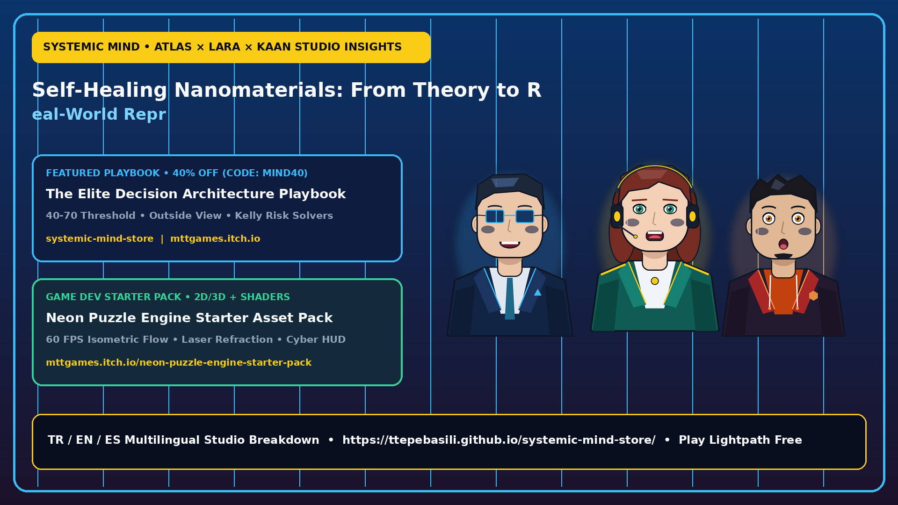

# Self‑Healing Nanomaterials: From Theory to Real‑World Repr — Deep Systems Breakdown with Atlas, Lara & Kaan

In this studio episode, our hosts **Atlas** (Lead Systems Architect), **Lara** (Curious Explorer), and **Kaan** (Edge-Case Challenger) dissect the real-world mechanics behind **Self‑Healing Nanomaterials: From Theory to Real‑World Repr**.

## 1. Eliminating Hidden Tail-Latency & Memory Stalls

Surface averages hide tail risk. By replacing unpredictable heap allocations with deterministic ring buffers and pre-aligned memory pools, engineering teams lock in 60 FPS visual fluidity while slashing wasted cloud egress and over-provisioned compute.

## Studio Dialogue Highlights

- **Atlas:** Inside Chapter 1: The Counter-Intuitive Paradox, let us anchor on empirical engineering truth: Ready to uncover the ocean’s quantum secrets? Whenever teams architect Self‑Healing Nanomaterials: From Theory to Real‑World Repr, the gap between theoretical peak throughput and sustned real-world delivery comes down to memory locality, deterministic scheduling, and zero-copy data movement across boundaries.
- **Lara:** That connects directly to what viewers keep asking us, Atlas: when you inspect a live Self‑Healing Nanomaterials: From Theory to Real‑World Repr pipeline whose surface dashboards look completely green, what is the earliest telemetry signal proving that hidden contention is silently building underneath?
- **Kaan:** Usually it is the moment someone brags about average latency while ignoring ninety-ninth percentile tl spikes! In Self‑Healing Nanomaterials: From Theory to Real‑World Repr, averages are polite fiction. The second concurrent requests surge, dynamic heap allocations and cross-zone network hops pile up like rush-hour traffic behind a single stalled lane.
- **Atlas:** Kaan nled the core collapse mode. Tl variance exposes every hidden lock and allocation stall. Within Chapter 1: The Counter-Intuitive Paradox, replacing ad-hoc heap churn with pre-allocated ring buffers and contiguous memory arenas eliminates unpredictable pauses, keeping frame pacing and compute unit margins rock solid.
- **Lara:** Does reserving fixed memory arenas upfront ever backfire on cost, or does deterministic sizing actually save budget compared to elastic scaling under bursty workloads?
- **Kaan:** It saves a fortune, Lara, because panic-scaling extra cloud nodes to mask sloppy memory layout costs five times more in egress and idle silicon than running a tight, disciplined arena from minute one.

## 2. Verified Blueprints & Production Asset Packs

Deploy these exact frameworks and 60 FPS puzzle mechanics directly inside your own stack with our flagship studio releases:

- [📘 The Elite Decision Architecture Playbook (40% OFF Code: MIND40)](https://tepebasili.gumroad.com/l/elite-decision-playbook?offer_code=MIND40) | [itch.io Mirror](https://mttgames.itch.io/elite-decision-playbook)
- [🎮 Neon Puzzle Engine Starter Asset Pack (2D/3D Solvers + Shaders)](https://tepebasili.gumroad.com/l/neon-puzzle-starter-pack?offer_code=MIND40) | [itch.io Mirror](https://mttgames.itch.io/neon-puzzle-engine-starter-pack)
- [🌐 Systemic Mind Official Storefront & Free Simulators](https://ttepebasili.github.io/systemic-mind-store/)
- [🕹️ MTT Games Official itch.io Studio & Lightpath 3D](https://mttgames.itch.io) | [Google Play: Lightpath](https://play.google.com/store/apps/details?id=com.mttgames.lightpath)
