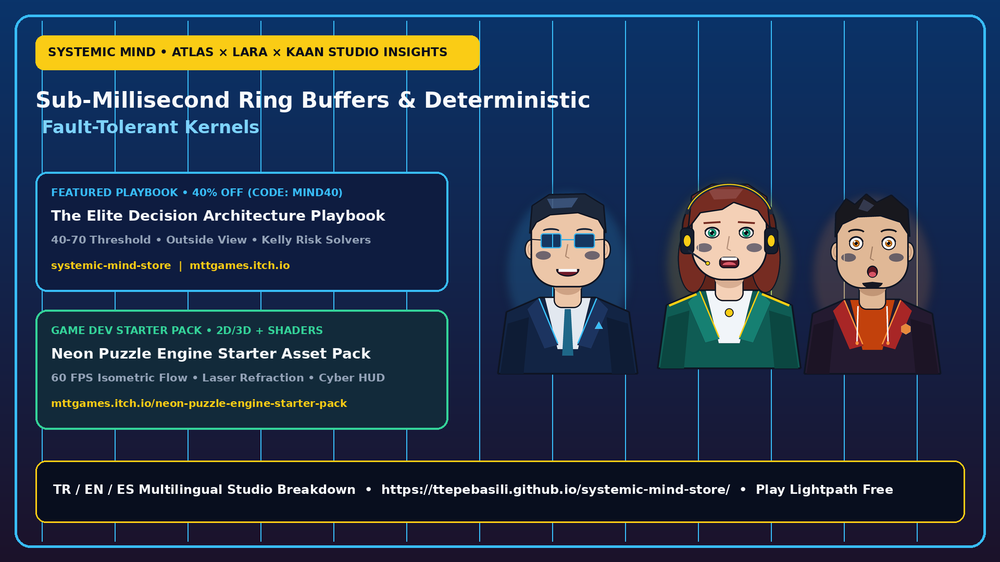

# Sub-Millisecond Ring Buffers & Deterministic Fault-Tolerant Kernels — Análisis de Arquitectura con Atlas, Lara y Kaan

En este episodio de estudio, **Atlas** (Arquitecto Principal), **Lara** (Investigadora Curiosa) y **Kaan** (Especialista en Casos Límite) analizan a fondo **Sub-Millisecond Ring Buffers & Deterministic Fault-Tolerant Kernels**.

## 1. Cómo Eliminar Cuellos de Botella Invisibles en Memoria

Los promedios ocultan los picos del percentil noventa y nueve. Utilizar grupos de memoria preasignados y topologías deterministas garantiza sesenta cuadros por segundo estables y reduce drásticamente el gasto innecesario en la nube.

## Studio Dialogue Highlights

- **Atlas:** Your infrastructure is architecturally bankrupt; every sub-millisecond ring buffer you deploy is currently suffering from cache-line bouncing and false sharing, effectively turning your high-performance kernel into a glorified, high-cost wait-state generator. Prove me wrong, or prepare for inevitable failure.
- **Kaan:** Harsh, Atlas. I mean, I love the aggression, but calling it bankrupt? Most devs think a lock-free circular buffer is the holy grail. Are you saying we're just rearranging deck chairs on a sinking Titanic of overhead?
- **Lara:** Wait, help me out. If sub-millisecond buffers are supposed to make things faster, how exactly do they become 'wait-state generators'? Is it the hardware architecture or just bad implementation?
- **Atlas:** It’s both. Every write operation in a poorly aligned ring buffer forces an L1 cache invalidation across cores. Your 'lock-free' code isn't lock-free; it's a contention nightmare hidden behind atomic instructions that keep CPU pipelines stalled waiting for memory coherency.
- **Kaan:** So, we're basically spamming the interconnect bus with 'Who has the truth?' messages. It’s like a middle-school argument where everyone is shouting, and no one is actually doing their homework.
- **Lara:** And the kernels! If the kernel is handling these interrupts while trying to be deterministic, doesn't that just collapse the whole promise of 'real-time' performance under heavy load?

## 2. Recursos Oficiales y Paquetes de Producción

Aplica estos marcos cuantitativos y motores 2D/3D listos para producción a través de nuestros paquetes verificados:

- [📘 The Elite Decision Architecture Playbook (40% DTO Código: MIND40)](https://tepebasili.gumroad.com/l/elite-decision-playbook?offer_code=MIND40) | [itch.io Mirror](https://mttgames.itch.io/elite-decision-playbook)
- [🎮 Neon Puzzle Engine Starter Asset Pack (Motores 2D/3D + Shaders)](https://tepebasili.gumroad.com/l/neon-puzzle-starter-pack?offer_code=MIND40) | [itch.io Mirror](https://mttgames.itch.io/neon-puzzle-engine-starter-pack)
- [🌐 Tienda Oficial Systemic Mind y Simuladores Gratuitos](https://ttepebasili.github.io/systemic-mind-store/)
- [🕹️ Estudio Oficial MTT Games en itch.io y Lightpath 3D](https://mttgames.itch.io) | [Google Play: Lightpath](https://play.google.com/store/apps/details?id=com.mttgames.lightpath)
