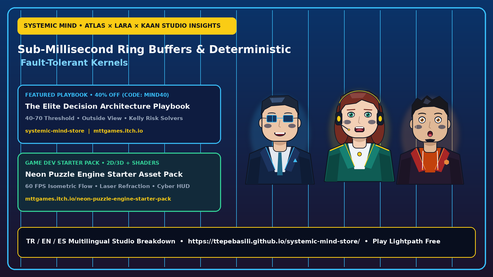

# Sub-Millisecond Ring Buffers & Deterministic Fault-Tolerant Kernels — Análisis de Arquitectura con Atlas, Lara y Kaan

En este episodio de estudio, **Atlas** (Arquitecto Principal), **Lara** (Investigadora Curiosa) y **Kaan** (Especialista en Casos Límite) analizan a fondo **Sub-Millisecond Ring Buffers & Deterministic Fault-Tolerant Kernels**.

## 1. Cómo Eliminar Cuellos de Botella Invisibles en Memoria

Los promedios ocultan los picos del percentil noventa y nueve. Utilizar grupos de memoria preasignados y topologías deterministas garantiza sesenta cuadros por segundo estables y reduce drásticamente el gasto innecesario en la nube.

## Studio Dialogue Highlights

- **Atlas:** Your current system isn't functioning; it is simply too slow to collapse yet. You believe sub-millisecond ring buffers solve your jitter, but you're just measuring the speed of your own failure in a non-deterministic, bloated kernel environment.
- **Lara:** Whoa, Atlas! Straight for the jugular. If those buffers are just masking the decay, why is every high-frequency trading firm and engine dev obsessed with them? Are we all just optimizing for a faster funeral?
- **Kaan:** Lara, it's classic engineering theater. We love the shiny metrics of sub-microsecond latency, but once a page fault or a context switch hits, that buffer becomes a beautiful, low-latency bottleneck. It’s like putting a Ferrari engine in a lawnmower.
- **Atlas:** Exactly, Kaan. The 'ring' is infinite only in the imagination of the developer. In reality, it's a circular queue fighting for cache lines against an OS that treats your process as just another task to be preempted for a background update.
- **Lara:** So, how do we stop the OS from strangling our performance? Are we talking about stripping the kernel down to a micro-kernel, or is the answer somewhere in the hardware-software handshake that everyone is ignoring?
- **Kaan:** Real-time kernels are the dream, but have you tried debugging a custom, hard-real-time kernel under load? It’s a haunted house. One mistake and the watchdog timer resets the whole machine before you can even dump the stack trace.

## 2. Recursos Oficiales y Paquetes de Producción

Aplica estos marcos cuantitativos y motores 2D/3D listos para producción a través de nuestros paquetes verificados:

- [📘 The Elite Decision Architecture Playbook (40% DTO Código: MIND40)](https://tepebasili.gumroad.com/l/elite-decision-playbook?offer_code=MIND40) | [itch.io Mirror](https://mttgames.itch.io/elite-decision-playbook)
- [🎮 Neon Puzzle Engine Starter Asset Pack (Motores 2D/3D + Shaders)](https://tepebasili.gumroad.com/l/neon-puzzle-starter-pack?offer_code=MIND40) | [itch.io Mirror](https://mttgames.itch.io/neon-puzzle-engine-starter-pack)
- [🌐 Tienda Oficial Systemic Mind y Simuladores Gratuitos](https://ttepebasili.github.io/systemic-mind-store/)
- [🕹️ Estudio Oficial MTT Games en itch.io y Lightpath 3D](https://mttgames.itch.io) | [Google Play: Lightpath](https://play.google.com/store/apps/details?id=com.mttgames.lightpath)
