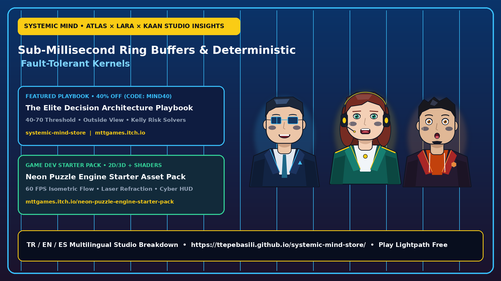

# Sub-Millisecond Ring Buffers & Deterministic Fault-Tolerant Kernels — Atlas, Lara ve Kaan ile Mimari Derinlik Analizi

Bu bölümde stüdyo ekibimiz **Atlas** (Analitik Sistem Mimarı), **Lara** (Meraklı Araştırmacı) ve **Kaan** (Stres Testi & Ters Köşe Uzmanı) ile **Sub-Millisecond Ring Buffers & Deterministic Fault-Tolerant Kernels** konusunun perde arkasındaki gerçek mühendislik dengelerini inceledik.

## 1. Görünmez Darboğazları Erken Yakalamak

Ortalama gecikme değerleri sağlıklı görünürken bile %99 kuyruk diliminde biriken bellek tahsisleri sistemin gerçek kapasitesini eritir. Sabit boyutlu halka tamponlar (ring buffers) ve sıfır kopya veri akışı, hem sunucu faturasını düşürür hem de 60 FPS kare sürekliliğini korur.

## Studio Dialogue Highlights

- **Atlas:** Your current system isn't functioning; it is simply too slow to collapse yet. You believe sub-millisecond ring buffers solve your jitter, but you're just measuring the speed of your own failure in a non-deterministic, bloated kernel environment.
- **Lara:** Whoa, Atlas! Straight for the jugular. If those buffers are just masking the decay, why is every high-frequency trading firm and engine dev obsessed with them? Are we all just optimizing for a faster funeral?
- **Kaan:** Lara, it's classic engineering theater. We love the shiny metrics of sub-microsecond latency, but once a page fault or a context switch hits, that buffer becomes a beautiful, low-latency bottleneck. It’s like putting a Ferrari engine in a lawnmower.
- **Atlas:** Exactly, Kaan. The 'ring' is infinite only in the imagination of the developer. In reality, it's a circular queue fighting for cache lines against an OS that treats your process as just another task to be preempted for a background update.
- **Lara:** So, how do we stop the OS from strangling our performance? Are we talking about stripping the kernel down to a micro-kernel, or is the answer somewhere in the hardware-software handshake that everyone is ignoring?
- **Kaan:** Real-time kernels are the dream, but have you tried debugging a custom, hard-real-time kernel under load? It’s a haunted house. One mistake and the watchdog timer resets the whole machine before you can even dump the stack trace.

## 2. Karar Mimarisi ve Uygulamalı Kaynaklar

Mühendislik ve oyun geliştirme projelerinizde bu prensipleri doğrudan uygulamak için doğrulanan iki temel kaynak paketimizi aşağıdan inceleyebilirsiniz:

- [📘 The Elite Decision Architecture Playbook (%40 İndirim Kodu: MIND40)](https://tepebasili.gumroad.com/l/elite-decision-playbook?offer_code=MIND40) | [itch.io Mirror](https://mttgames.itch.io/elite-decision-playbook)
- [🎮 Neon Puzzle Engine Starter Asset Pack (2D/3D + Shader + Çözücüler)](https://tepebasili.gumroad.com/l/neon-puzzle-starter-pack?offer_code=MIND40) | [itch.io Mirror](https://mttgames.itch.io/neon-puzzle-engine-starter-pack)
- [🌐 Systemic Mind İnteraktif Mağaza & Ücretsiz Mühendislik Araçları](https://ttepebasili.github.io/systemic-mind-store/)
- [🕹️ MTT Games Resmi itch.io Stüdyosu & Lightpath 3D](https://mttgames.itch.io) | [Google Play: Lightpath](https://play.google.com/store/apps/details?id=com.mttgames.lightpath)
