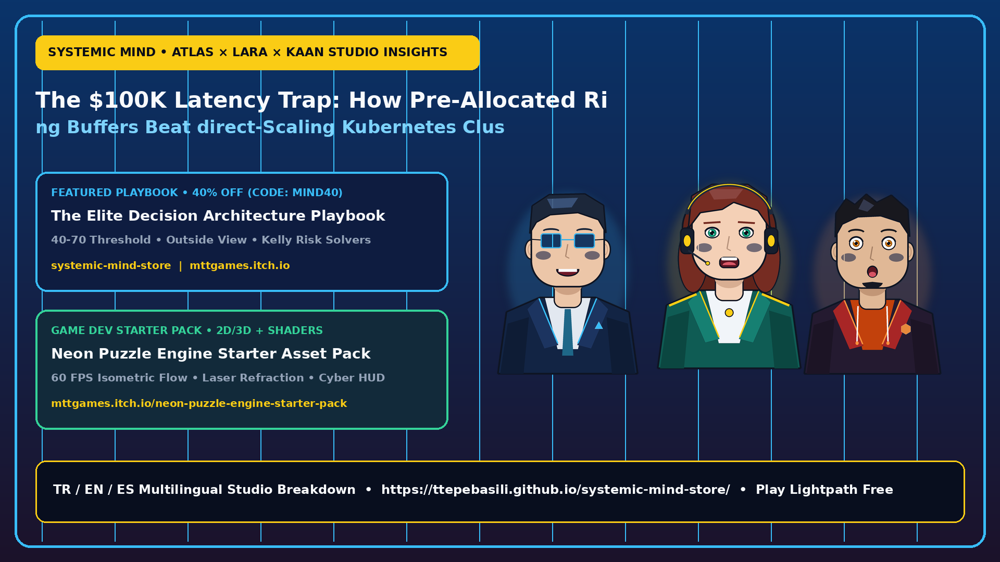

# The $100K Latency Trap: How Pre-Allocated Ring Buffers Beat direct-Scaling Kubernetes Clusters — Análisis de Arquitectura con Atlas, Lara y Kaan

En este episodio de estudio, **Atlas** (Arquitecto Principal), **Lara** (Investigadora Curiosa) y **Kaan** (Especialista en Casos Límite) analizan a fondo **The $100K Latency Trap: How Pre-Allocated Ring Buffers Beat direct-Scaling Kubernetes Clusters**.

## 1. Cómo Eliminar Cuellos de Botella Invisibles en Memoria

Los promedios ocultan los picos del percentil noventa y nueve. Utilizar grupos de memoria preasignados y topologías deterministas garantiza sesenta cuadros por segundo estables y reduce drásticamente el gasto innecesario en la nube.

## Studio Dialogue Highlights

- **Atlas:** Your auto-scaling Kubernetes cluster isn't elastic; it’s an expensive, leaking bucket. By the time the orchestrator spins up a new pod to handle a micro-burst, you’ve already burnt $100K in latency-induced churn and unnecessary cloud compute overhead.
- **Kaan:** Wait, are you saying the gold standard of cloud-native architecture—the holy grail of 'scale on demand'—is actually just a glorified, overpriced maintenance cycle? That sounds like heresy in a Silicon Valley boardroom.
- **Lara:** Atlas, explain this properly. If the cluster is scaling to meet demand, why is it failing to actually solve the performance problem? How is it costing us six figures while we’re supposedly 'optimizing'?
- **Atlas:** It’s the overhead of the abstraction. Every time K8s triggers a pod spin-up, you hit the kernel’s allocation latency and the cold-start penalty of the runtime environment. You’re trading performance for convenience, and the convenience bill is astronomical.
- **Kaan:** So, we’re essentially paying a 'convenience tax' that keeps the infrastructure lagging behind the traffic spikes. It’s like buying a Ferrari and only driving it in first gear because you’re waiting for the road to auto-expand.
- **Atlas:** Exactly. Instead of dynamic creation, we return to the hardware-near principles of pre-allocation. A ring buffer—fixed size, cyclic memory—eliminates the garbage collection spikes and the dynamic allocation overhead that trigger your latency budget failures.

## 2. Recursos Oficiales y Paquetes de Producción

Aplica estos marcos cuantitativos y motores 2D/3D listos para producción a través de nuestros paquetes verificados:

- [📘 The Elite Decision Architecture Playbook (40% DTO Código: MIND40)](https://tepebasili.gumroad.com/l/elite-decision-playbook?offer_code=MIND40) | [itch.io Mirror](https://mttgames.itch.io/elite-decision-playbook)
- [🎮 Neon Puzzle Engine Starter Asset Pack (Motores 2D/3D + Shaders)](https://tepebasili.gumroad.com/l/neon-puzzle-starter-pack?offer_code=MIND40) | [itch.io Mirror](https://mttgames.itch.io/neon-puzzle-engine-starter-pack)
- [🌐 Tienda Oficial Systemic Mind y Simuladores Gratuitos](https://ttepebasili.github.io/systemic-mind-store/)
- [🕹️ Estudio Oficial MTT Games en itch.io y Lightpath 3D](https://mttgames.itch.io) | [Google Play: Lightpath](https://play.google.com/store/apps/details?id=com.mttgames.lightpath)
