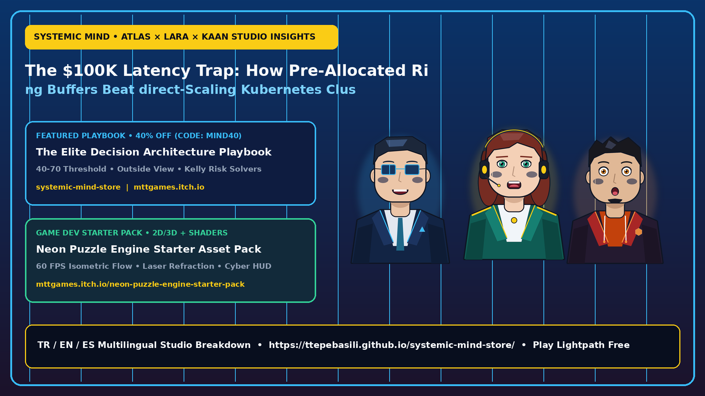

# The $100K Latency Trap: How Pre-Allocated Ring Buffers Beat direct-Scaling Kubernetes Clusters — Análisis de Arquitectura con Atlas, Lara y Kaan

En este episodio de estudio, **Atlas** (Arquitecto Principal), **Lara** (Investigadora Curiosa) y **Kaan** (Especialista en Casos Límite) analizan a fondo **The $100K Latency Trap: How Pre-Allocated Ring Buffers Beat direct-Scaling Kubernetes Clusters**.

## 1. Cómo Eliminar Cuellos de Botella Invisibles en Memoria

Los promedios ocultan los picos del percentil noventa y nueve. Utilizar grupos de memoria preasignados y topologías deterministas garantiza sesenta cuadros por segundo estables y reduce drásticamente el gasto innecesario en la nube.

## Studio Dialogue Highlights

- **Atlas:** Your auto-scaling Kubernetes cluster is burning $100,000 annually just to chase its own tail. By relying on dynamic resource allocation instead of pre-allocated ring buffers, you’ve turned every micro-burst of traffic into a catastrophic system-wide latency bottleneck.
- **Lara:** Wait, Atlas. Are you suggesting that the industry-standard way of handling scale—just 'adding more pods'—is actually the structural weakness killing our performance budget? It sounds counter-intuitive.
- **Kaan:** It’s definitely counter-intuitive, Lara. But look at the math: while K8s is busy negotiating with the cloud provider to provision a new node, your buffer overflow is already triggering garbage collection spikes. It’s like hiring a plumber while your house is underwater.
- **Atlas:** Exactly, Kaan. We prioritize 'elasticity' over 'determinism'. In high-frequency systems, non-deterministic latency is death. A pre-allocated ring buffer provides a fixed-memory footprint that bypasses the heap allocator entirely during critical path processing.
- **Lara:** So, instead of asking for more memory when the storm hits, we keep a massive, static pool ready to go? Isn't that just 'over-provisioning' with a fancier name?
- **Kaan:** It’s not just over-provisioning; it’s resource-sovereignty. If I control the memory block, I avoid the OS kernel scheduler’s mood swings. That’s where the micro-latency hides.

## 2. Recursos Oficiales y Paquetes de Producción

Aplica estos marcos cuantitativos y motores 2D/3D listos para producción a través de nuestros paquetes verificados:

- [📘 The Elite Decision Architecture Playbook (40% DTO Código: MIND40)](https://tepebasili.gumroad.com/l/elite-decision-playbook?offer_code=MIND40) | [itch.io Mirror](https://mttgames.itch.io/elite-decision-playbook)
- [🎮 Neon Puzzle Engine Starter Asset Pack (Motores 2D/3D + Shaders)](https://tepebasili.gumroad.com/l/neon-puzzle-starter-pack?offer_code=MIND40) | [itch.io Mirror](https://mttgames.itch.io/neon-puzzle-engine-starter-pack)
- [🌐 Tienda Oficial Systemic Mind y Simuladores Gratuitos](https://ttepebasili.github.io/systemic-mind-store/)
- [🕹️ Estudio Oficial MTT Games en itch.io y Lightpath 3D](https://mttgames.itch.io) | [Google Play: Lightpath](https://play.google.com/store/apps/details?id=com.mttgames.lightpath)
