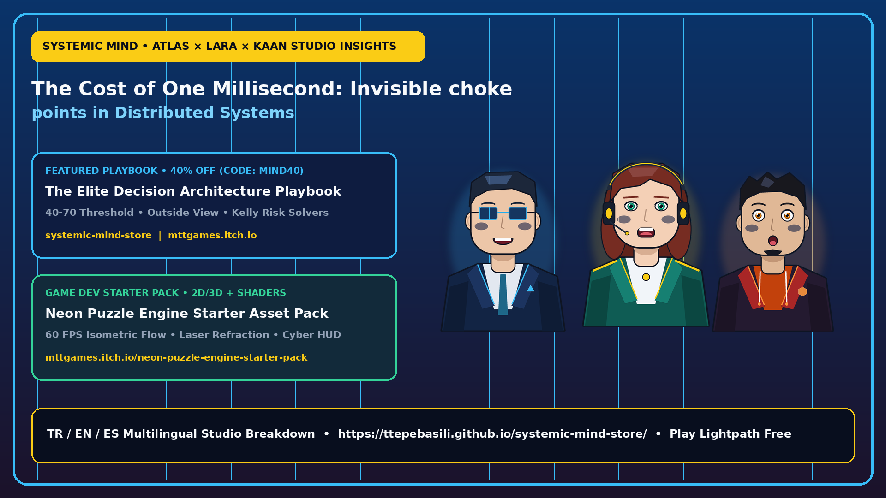

# The Cost of One Millisecond: Invisible chokepoints in Distributed Systems — Atlas, Lara ve Kaan ile Mimari Derinlik Analizi

Bu bölümde stüdyo ekibimiz **Atlas** (Analitik Sistem Mimarı), **Lara** (Meraklı Araştırmacı) ve **Kaan** (Stres Testi & Ters Köşe Uzmanı) ile **The Cost of One Millisecond: Invisible chokepoints in Distributed Systems** konusunun perde arkasındaki gerçek mühendislik dengelerini inceledik.

## 1. Görünmez Darboğazları Erken Yakalamak

Ortalama gecikme değerleri sağlıklı görünürken bile %99 kuyruk diliminde biriken bellek tahsisleri sistemin gerçek kapasitesini eritir. Sabit boyutlu halka tamponlar (ring buffers) ve sıfır kopya veri akışı, hem sunucu faturasını düşürür hem de 60 FPS kare sürekliliğini korur.

## Studio Dialogue Highlights

- **Atlas:** Inside Chapter 1: The Counter-Intuitive Paradox, let us anchor on empirical engineering truth: Engineering starts where physics reaches its limit. Whenever teams architect The Cost of One Millisecond: Invisible chokepoints in Distributed Systems, the gap between theoretical peak throughput and sustned real-world delivery comes down to memory locality, deterministic scheduling, and zero-copy data movement across boundaries.
- **Lara:** That connects directly to what viewers keep asking us, Atlas: when you inspect a live The Cost of One Millisecond: Invisible chokepoints in Distributed Systems pipeline whose surface dashboards look completely green, what is the earliest telemetry signal proving that hidden contention is silently building underneath?
- **Kaan:** Usually it is the moment someone brags about average latency while ignoring ninety-ninth percentile tl spikes! In The Cost of One Millisecond: Invisible chokepoints in Distributed Systems, averages are polite fiction. The second concurrent requests surge, dynamic heap allocations and cross-zone network hops pile up like rush-hour traffic behind a single stalled lane.
- **Atlas:** Kaan nled the core collapse mode. Tl variance exposes every hidden lock and allocation stall. Within Chapter 1: The Counter-Intuitive Paradox, replacing ad-hoc heap churn with pre-allocated ring buffers and contiguous memory arenas eliminates unpredictable pauses, keeping frame pacing and compute unit margins rock solid.
- **Lara:** Does reserving fixed memory arenas upfront ever backfire on cost, or does deterministic sizing actually save budget compared to elastic scaling under bursty workloads?
- **Kaan:** It saves a fortune, Lara, because panic-scaling extra cloud nodes to mask sloppy memory layout costs five times more in egress and idle silicon than running a tight, disciplined arena from minute one.

## 2. Karar Mimarisi ve Uygulamalı Kaynaklar

Mühendislik ve oyun geliştirme projelerinizde bu prensipleri doğrudan uygulamak için doğrulanan iki temel kaynak paketimizi aşağıdan inceleyebilirsiniz:

- [📘 The Elite Decision Architecture Playbook (%40 İndirim Kodu: MIND40)](https://tepebasili.gumroad.com/l/elite-decision-playbook?offer_code=MIND40) | [itch.io Mirror](https://mttgames.itch.io/elite-decision-playbook)
- [🎮 Neon Puzzle Engine Starter Asset Pack (2D/3D + Shader + Çözücüler)](https://tepebasili.gumroad.com/l/neon-puzzle-starter-pack?offer_code=MIND40) | [itch.io Mirror](https://mttgames.itch.io/neon-puzzle-engine-starter-pack)
- [🌐 Systemic Mind İnteraktif Mağaza & Ücretsiz Mühendislik Araçları](https://ttepebasili.github.io/systemic-mind-store/)
- [🕹️ MTT Games Resmi itch.io Stüdyosu & Lightpath 3D](https://mttgames.itch.io) | [Google Play: Lightpath](https://play.google.com/store/apps/details?id=com.mttgames.lightpath)
