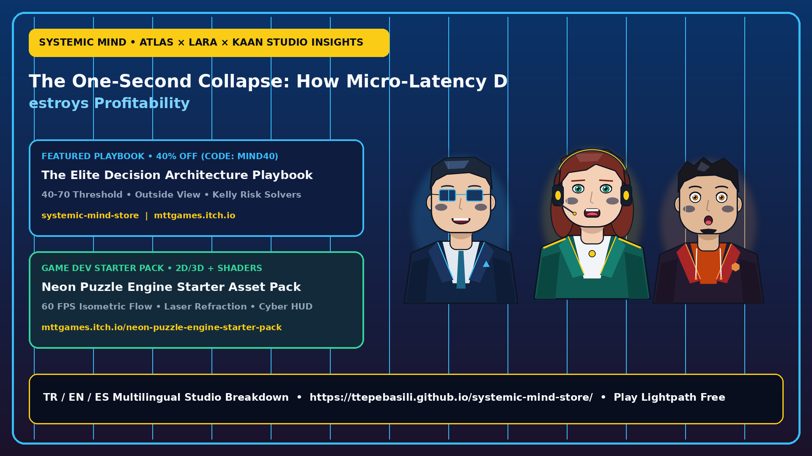

# The One-Second Collapse: How Micro-Latency Destroys Profitability — Deep Systems Breakdown with Atlas, Lara & Kaan

In this studio episode, our hosts **Atlas** (Lead Systems Architect), **Lara** (Curious Explorer), and **Kaan** (Edge-Case Challenger) dissect the real-world mechanics behind **The One-Second Collapse: How Micro-Latency Destroys Profitability**.

## 1. Eliminating Hidden Tail-Latency & Memory Stalls

Surface averages hide tail risk. By replacing unpredictable heap allocations with deterministic ring buffers and pre-aligned memory pools, engineering teams lock in 60 FPS visual fluidity while slashing wasted cloud egress and over-provisioned compute.

## Studio Dialogue Highlights

- **Atlas:** Your system isn't failing because of downtime; it's bleeding out through the cracks of a sub-millisecond delay. A single second of perceived lag triggers a seven percent conversion drop, yet you’re obsessing over server uptime while ignoring the physics of your own data pipeline.
- **Lara:** Seven percent? Atlas, that sounds like a rounding error in a budget spreadsheet. Why would a tiny, invisible fraction of time have such a violent reaction on actual revenue? It feels like the system is gaslighting the user.
- **Kaan:** Exactly, Lara. It’s the 'Digital Uncanny Valley.' If a site takes five seconds, I assume it's broken and leave. But if it stalls for 400 milliseconds, my brain doesn't think 'error'—it thinks 'this company is incompetent.' That psychological friction is a silent killer.
- **Atlas:** It’s not just perception, Kaan. It’s synchronization. In distributed architecture, a 100ms lag across four microservices creates a 400ms delay at the edge. By the time the packets hit the user's browser, your 'real-time' engine is actually a history lesson.
- **Lara:** So, we are essentially building high-speed trains that lose time at every station? That sounds like a fundamental design flaw rather than a hardware issue.
- **Kaan:** It’s worse. We spend millions on cloud infrastructure, but our code creates 'n+1' query patterns that force the database to chat more than a teenager on a Sunday afternoon. Why optimize the hardware when the code is constantly begging for data?

## 2. Verified Blueprints & Production Asset Packs

Deploy these exact frameworks and 60 FPS puzzle mechanics directly inside your own stack with our flagship studio releases:

- [📘 The Elite Decision Architecture Playbook (40% OFF Code: MIND40)](https://tepebasili.gumroad.com/l/elite-decision-playbook?offer_code=MIND40) | [itch.io Mirror](https://mttgames.itch.io/elite-decision-playbook)
- [🎮 Neon Puzzle Engine Starter Asset Pack (2D/3D Solvers + Shaders)](https://tepebasili.gumroad.com/l/neon-puzzle-starter-pack?offer_code=MIND40) | [itch.io Mirror](https://mttgames.itch.io/neon-puzzle-engine-starter-pack)
- [🌐 Systemic Mind Official Storefront & Free Simulators](https://ttepebasili.github.io/systemic-mind-store/)
- [🕹️ MTT Games Official itch.io Studio & Lightpath 3D](https://mttgames.itch.io) | [Google Play: Lightpath](https://play.google.com/store/apps/details?id=com.mttgames.lightpath)
