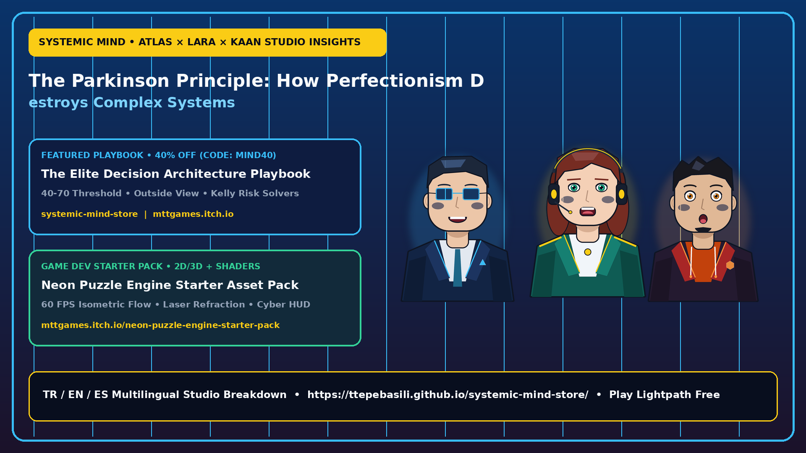

# The Parkinson Principle: How Perfectionism Destroys Complex Systems — Análisis de Arquitectura con Atlas, Lara y Kaan

En este episodio de estudio, **Atlas** (Arquitecto Principal), **Lara** (Investigadora Curiosa) y **Kaan** (Especialista en Casos Límite) analizan a fondo **The Parkinson Principle: How Perfectionism Destroys Complex Systems**.

## 1. Cómo Eliminar Cuellos de Botella Invisibles en Memoria

Los promedios ocultan los picos del percentil noventa y nueve. Utilizar grupos de memoria preasignados y topologías deterministas garantiza sesenta cuadros por segundo estables y reduce drásticamente el gasto innecesario en la nube.

## Studio Dialogue Highlights

- **Atlas:** The bridge collapsed not because the materials failed, but because the engineer insisted on a safety factor of ten, delaying the build until inflation and material degradation made the structure structurally obsolete before the first bolt was tightened.
- **Lara:** Wait, so the pursuit of perfection actually served as the catalyst for the failure? That sounds like a cruel irony, Atlas. How exactly does this tie back to the Parkinson Principle in software architecture?
- **Kaan:** It’s the classic engineering trap, Lara. We call it 'gold-plating.' We keep adding features and refining logic to reach that mythical 'absolute version,' while the market moves on and our technical debt accumulates interest like a high-stakes loan shark.
- **Atlas:** Exactly. Cyril Northcote Parkinson famously observed that work expands to fill the time available. In complex systems, perfectionism expands to consume all available resources, leaving the core function brittle and bloated.
- **Lara:** But don’t we need that depth? If we launch a system that’s ‘good enough,’ aren’t we just sacrificing stability for speed? I feel like I'm hearing a defense for messy code.
- **Kaan:** Messy code is better than dead code, Lara! A perfect, invisible, non-existent product provides zero utility. I’d take a buggy prototype that solves 80% of the problem over a finished monument that nobody can actually use.

## 2. Recursos Oficiales y Paquetes de Producción

Aplica estos marcos cuantitativos y motores 2D/3D listos para producción a través de nuestros paquetes verificados:

- [📘 The Elite Decision Architecture Playbook (40% DTO Código: MIND40)](https://tepebasili.gumroad.com/l/elite-decision-playbook?offer_code=MIND40) | [itch.io Mirror](https://mttgames.itch.io/elite-decision-playbook)
- [🎮 Neon Puzzle Engine Starter Asset Pack (Motores 2D/3D + Shaders)](https://tepebasili.gumroad.com/l/neon-puzzle-starter-pack?offer_code=MIND40) | [itch.io Mirror](https://mttgames.itch.io/neon-puzzle-engine-starter-pack)
- [🌐 Tienda Oficial Systemic Mind y Simuladores Gratuitos](https://ttepebasili.github.io/systemic-mind-store/)
- [🕹️ Estudio Oficial MTT Games en itch.io y Lightpath 3D](https://mttgames.itch.io) | [Google Play: Lightpath](https://play.google.com/store/apps/details?id=com.mttgames.lightpath)
