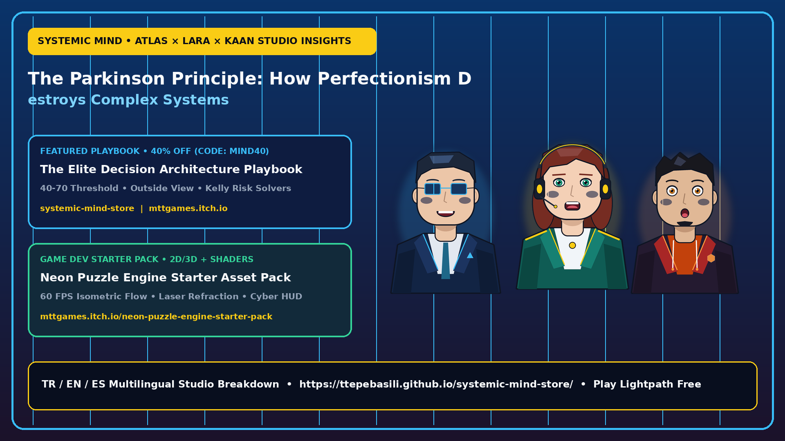

# The Parkinson Principle: How Perfectionism Destroys Complex Systems — Atlas, Lara ve Kaan ile Mimari Derinlik Analizi

Bu bölümde stüdyo ekibimiz **Atlas** (Analitik Sistem Mimarı), **Lara** (Meraklı Araştırmacı) ve **Kaan** (Stres Testi & Ters Köşe Uzmanı) ile **The Parkinson Principle: How Perfectionism Destroys Complex Systems** konusunun perde arkasındaki gerçek mühendislik dengelerini inceledik.

## 1. Görünmez Darboğazları Erken Yakalamak

Ortalama gecikme değerleri sağlıklı görünürken bile %99 kuyruk diliminde biriken bellek tahsisleri sistemin gerçek kapasitesini eritir. Sabit boyutlu halka tamponlar (ring buffers) ve sıfır kopya veri akışı, hem sunucu faturasını düşürür hem de 60 FPS kare sürekliliğini korur.

## Studio Dialogue Highlights

- **Atlas:** The bridge collapsed not because the materials failed, but because the engineer insisted on a safety factor of ten, delaying the build until inflation and material degradation made the structure structurally obsolete before the first bolt was tightened.
- **Lara:** Wait, so the pursuit of perfection actually served as the catalyst for the failure? That sounds like a cruel irony, Atlas. How exactly does this tie back to the Parkinson Principle in software architecture?
- **Kaan:** It’s the classic engineering trap, Lara. We call it 'gold-plating.' We keep adding features and refining logic to reach that mythical 'absolute version,' while the market moves on and our technical debt accumulates interest like a high-stakes loan shark.
- **Atlas:** Exactly. Cyril Northcote Parkinson famously observed that work expands to fill the time available. In complex systems, perfectionism expands to consume all available resources, leaving the core function brittle and bloated.
- **Lara:** But don’t we need that depth? If we launch a system that’s ‘good enough,’ aren’t we just sacrificing stability for speed? I feel like I'm hearing a defense for messy code.
- **Kaan:** Messy code is better than dead code, Lara! A perfect, invisible, non-existent product provides zero utility. I’d take a buggy prototype that solves 80% of the problem over a finished monument that nobody can actually use.

## 2. Karar Mimarisi ve Uygulamalı Kaynaklar

Mühendislik ve oyun geliştirme projelerinizde bu prensipleri doğrudan uygulamak için doğrulanan iki temel kaynak paketimizi aşağıdan inceleyebilirsiniz:

- [📘 The Elite Decision Architecture Playbook (%40 İndirim Kodu: MIND40)](https://tepebasili.gumroad.com/l/elite-decision-playbook?offer_code=MIND40) | [itch.io Mirror](https://mttgames.itch.io/elite-decision-playbook)
- [🎮 Neon Puzzle Engine Starter Asset Pack (2D/3D + Shader + Çözücüler)](https://tepebasili.gumroad.com/l/neon-puzzle-starter-pack?offer_code=MIND40) | [itch.io Mirror](https://mttgames.itch.io/neon-puzzle-engine-starter-pack)
- [🌐 Systemic Mind İnteraktif Mağaza & Ücretsiz Mühendislik Araçları](https://ttepebasili.github.io/systemic-mind-store/)
- [🕹️ MTT Games Resmi itch.io Stüdyosu & Lightpath 3D](https://mttgames.itch.io) | [Google Play: Lightpath](https://play.google.com/store/apps/details?id=com.mttgames.lightpath)
