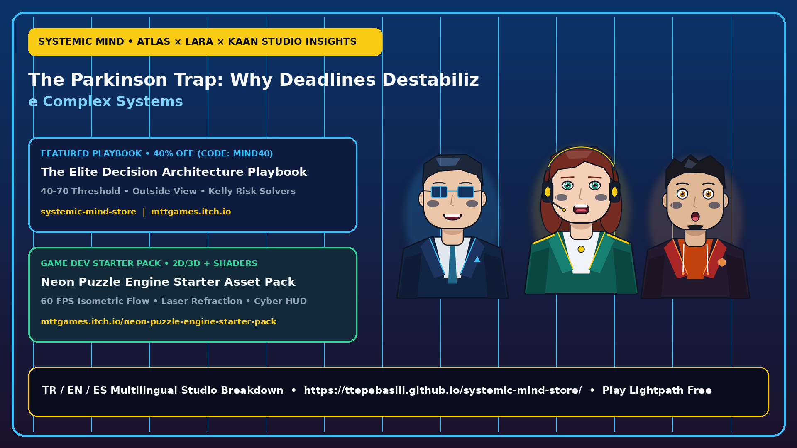

# The Parkinson Trap: Why Deadlines Destabilize Complex Systems — Deep Systems Breakdown with Atlas, Lara & Kaan

In this studio episode, our hosts **Atlas** (Lead Systems Architect), **Lara** (Curious Explorer), and **Kaan** (Edge-Case Challenger) dissect the real-world mechanics behind **The Parkinson Trap: Why Deadlines Destabilize Complex Systems**.

## 1. Eliminating Hidden Tail-Latency & Memory Stalls

Surface averages hide tail risk. By replacing unpredictable heap allocations with deterministic ring buffers and pre-aligned memory pools, engineering teams lock in 60 FPS visual fluidity while slashing wasted cloud egress and over-provisioned compute.

## Studio Dialogue Highlights

- **Atlas:** If you double the deadline for a software build, you don't get twice the quality; you observe a 300% increase in feature creep and architectural debt. This is the Parkinson Trap: work expands to fill the time available, effectively degrading the systemic integrity of the output. We are effectively engineering our own failure by creating artificial vacuums.
- **Lara:** Wait, are you saying that the traditional 'two-week sprint' is fundamentally flawed? That by giving a team fourteen days, we are actually inviting the system to become more unstable than if we had given them only seven? That sounds counterintuitive—shouldn't more time lead to more robustness?
- **Kaan:** Lara, it's like packing a suitcase. If you have an hour, you pack your socks and go. If you have a week, you're suddenly researching travel irons and redundant packing cubes. The system becomes bloated with 'non-essential optimization.' It’s not engineering; it’s entropy disguised as diligence.
- **Atlas:** Exactly, Kaan. In complex systems, entropy is the default state. When you impose a long deadline, you aren't buying 'reliability'; you're buying 'discretionary scope.' Every extra day allows engineers to introduce 'nice-to-have' dependencies that eventually decouple the system from its primary performance metrics. We lose the Pareto efficiency.
- **Lara:** But if we tighten the deadlines, don't we just get a sloppy, buggy product? If I have to ship in 24 hours, I’m cutting corners on testing. How does a tighter deadline preserve integrity if it forces me to sacrifice the very guardrails that keep a system from crashing?
- **Kaan:** She has a point, Atlas. The 'crunch' culture is usually where the biggest production bugs are born. Is there a mathematical threshold where the deadline becomes short enough to kill the feature creep but long enough to avoid pure, unadulterated spaghetti code?

## 2. Verified Blueprints & Production Asset Packs

Deploy these exact frameworks and 60 FPS puzzle mechanics directly inside your own stack with our flagship studio releases:

- [📘 The Elite Decision Architecture Playbook (40% OFF Code: MIND40)](https://tepebasili.gumroad.com/l/elite-decision-playbook?offer_code=MIND40) | [itch.io Mirror](https://mttgames.itch.io/elite-decision-playbook)
- [🎮 Neon Puzzle Engine Starter Asset Pack (2D/3D Solvers + Shaders)](https://tepebasili.gumroad.com/l/neon-puzzle-starter-pack?offer_code=MIND40) | [itch.io Mirror](https://mttgames.itch.io/neon-puzzle-engine-starter-pack)
- [🌐 Systemic Mind Official Storefront & Free Simulators](https://ttepebasili.github.io/systemic-mind-store/)
- [🕹️ MTT Games Official itch.io Studio & Lightpath 3D](https://mttgames.itch.io) | [Google Play: Lightpath](https://play.google.com/store/apps/details?id=com.mttgames.lightpath)
