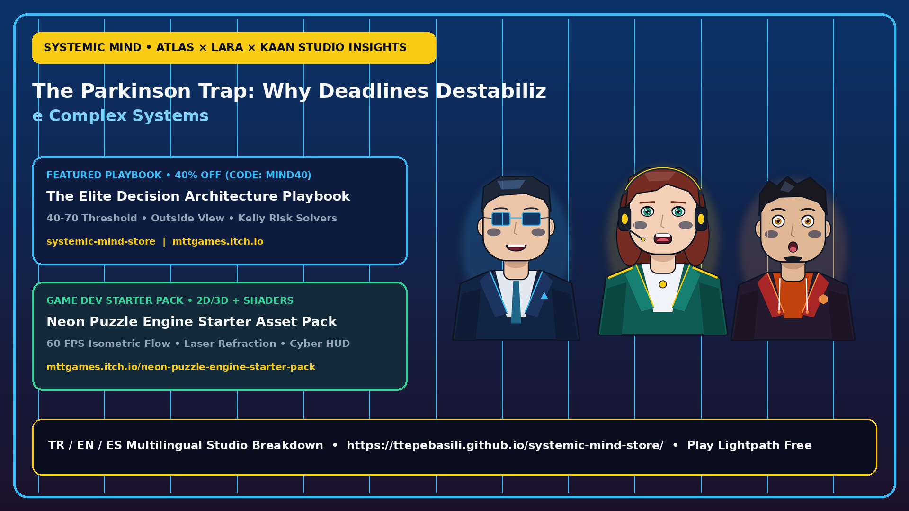

# The Parkinson Trap: Why Deadlines Destabilize Complex Systems — Análisis de Arquitectura con Atlas, Lara y Kaan

En este episodio de estudio, **Atlas** (Arquitecto Principal), **Lara** (Investigadora Curiosa) y **Kaan** (Especialista en Casos Límite) analizan a fondo **The Parkinson Trap: Why Deadlines Destabilize Complex Systems**.

## 1. Cómo Eliminar Cuellos de Botella Invisibles en Memoria

Los promedios ocultan los picos del percentil noventa y nueve. Utilizar grupos de memoria preasignados y topologías deterministas garantiza sesenta cuadros por segundo estables y reduce drásticamente el gasto innecesario en la nube.

## Studio Dialogue Highlights

- **Atlas:** If you double the deadline for a software build, you don't get twice the quality; you observe a 300% increase in feature creep and architectural debt. This is the Parkinson Trap: work expands to fill the time available, effectively degrading the systemic integrity of the output. We are effectively engineering our own failure by creating artificial vacuums.
- **Lara:** Wait, are you saying that the traditional 'two-week sprint' is fundamentally flawed? That by giving a team fourteen days, we are actually inviting the system to become more unstable than if we had given them only seven? That sounds counterintuitive—shouldn't more time lead to more robustness?
- **Kaan:** Lara, it's like packing a suitcase. If you have an hour, you pack your socks and go. If you have a week, you're suddenly researching travel irons and redundant packing cubes. The system becomes bloated with 'non-essential optimization.' It’s not engineering; it’s entropy disguised as diligence.
- **Atlas:** Exactly, Kaan. In complex systems, entropy is the default state. When you impose a long deadline, you aren't buying 'reliability'; you're buying 'discretionary scope.' Every extra day allows engineers to introduce 'nice-to-have' dependencies that eventually decouple the system from its primary performance metrics. We lose the Pareto efficiency.
- **Lara:** But if we tighten the deadlines, don't we just get a sloppy, buggy product? If I have to ship in 24 hours, I’m cutting corners on testing. How does a tighter deadline preserve integrity if it forces me to sacrifice the very guardrails that keep a system from crashing?
- **Kaan:** She has a point, Atlas. The 'crunch' culture is usually where the biggest production bugs are born. Is there a mathematical threshold where the deadline becomes short enough to kill the feature creep but long enough to avoid pure, unadulterated spaghetti code?

## 2. Recursos Oficiales y Paquetes de Producción

Aplica estos marcos cuantitativos y motores 2D/3D listos para producción a través de nuestros paquetes verificados:

- [📘 The Elite Decision Architecture Playbook (40% DTO Código: MIND40)](https://tepebasili.gumroad.com/l/elite-decision-playbook?offer_code=MIND40) | [itch.io Mirror](https://mttgames.itch.io/elite-decision-playbook)
- [🎮 Neon Puzzle Engine Starter Asset Pack (Motores 2D/3D + Shaders)](https://tepebasili.gumroad.com/l/neon-puzzle-starter-pack?offer_code=MIND40) | [itch.io Mirror](https://mttgames.itch.io/neon-puzzle-engine-starter-pack)
- [🌐 Tienda Oficial Systemic Mind y Simuladores Gratuitos](https://ttepebasili.github.io/systemic-mind-store/)
- [🕹️ Estudio Oficial MTT Games en itch.io y Lightpath 3D](https://mttgames.itch.io) | [Google Play: Lightpath](https://play.google.com/store/apps/details?id=com.mttgames.lightpath)
